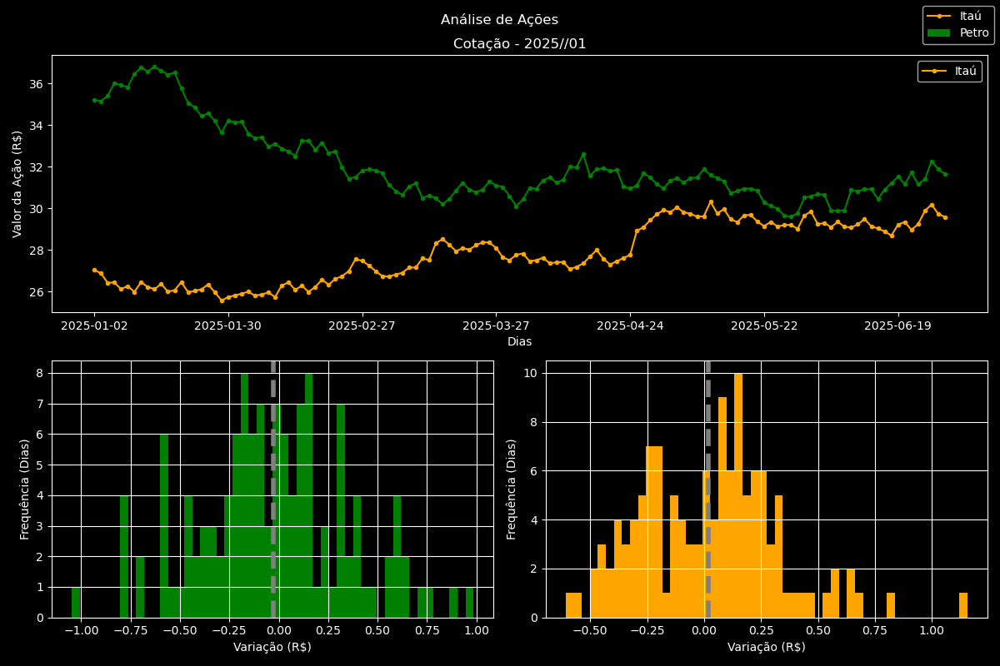

# Aprendendo Visualização de Dados na Prática (Pandas & Matplotlib)

Este repositório reúne meus primeiros passos práticos e exercícios para aprender a manipular bases de dados e gerar gráficos em Python. O objetivo aqui foi botar a mão na massa com as bibliotecas **Pandas** e **Matplotlib**, entendendo desde o carregamento dos arquivos até a estilização de imagens para análise visual.

Este projeto faz parte da minha jornada de estudos para construir uma base sólida e dar o pontapé inicial na área de análise de dados.

---

## 🎯 Objetivo do Repositório

* Praticar a leitura e manipulação de arquivos CSV usando Pandas.
* Aprender a estrutura básica da biblioteca Matplotlib (subplots, eixos, legendas e cores).
* Criar e personalizar gráficos de linhas, barras e áreas.
* Salvar as visualizações geradas diretamente em arquivos de imagem (`.png`).

---

## 🛠️ O que foi utilizado

* **Python 3**
* **Pandas:** para organização e filtro dos dados em DataFrames.
* **Matplotlib:** para a construção e visualização dos gráficos.
* **Jupyter Notebook:** ambiente usado para testar e rodar o código passo a passo.

---

## 📁 O que tem aqui dentro

```text
├── GeraçõesGráficas.ipynb  # Notebook onde fiz os testes e gerei os gráficos
├── dados.csv               # Base de dados utilizada nos exercícios
├── figura.png              # Exemplo de gráfico exportado pelo script
├── .gitignore              # Ignora arquivos temporários do Jupyter
└── README.md               # Documentação
```

---

## 🚀 Como rodar localmente

Se quiser clonar o repositório e testar os scripts na sua máquina:

1. Clone o repositório:
   ```bash
   git clone https://github.com/Sandro-Hugo/Graficos-Matplotlib-Pandas.git
   ```

2. Entre na pasta do projeto:
   ```bash
   cd Graficos-Matplotlib-Pandas
   ```

3. Instale as bibliotecas necessárias:
   ```bash
   pip install pandas matplotlib jupyter
   ```

4. Abra o Jupyter Notebook:
   ```bash
   jupyter notebook
   ```

---

## 📊 Exemplo do resultado

Um dos gráficos gerados e exportados durante os testes:



---

## 📌 Próximos passos

* Adicionar novos conjuntos de dados mais complexos.
* Praticar análises exploratórias completas (EDA).
* Explorar a biblioteca Seaborn para gráficos estatísticos avançados.

---

**Desenvolvido por Sandro Hugo**
